# Smart Minelayer

Adds the **Smart Minelayer** order: the ship lays mines or laser towers in a pattern you design on the map, refills and restocks them on its own, and its friend/foe mines keep fighting while you are away.

## Features

- **Patterns**: circle, square, hexagon, sphere, cube or the X4 logo, around a point in space or around a station or gate, with a radius, a density and a plane orientation. Concentric shapes, parallel layers and an offset from the target build larger fields from one pattern.
- **Up to nine fields per ship**: each field, called a slot, has its own target, sector, pattern and item count (up to 1000 items). Changing one slot leaves the items of the others in place.
- **Friend/foe mines or laser towers**: any friend/foe mine or laser tower the ship can carry. Package mines that release a whole cluster at once, such as the Cluster Mine, are left out.
- **Active while you are away**: the mines detonate on enemy ships while you are far from the field, where the game otherwise leaves them inert. A mine reaches as far as its trigger range, a tracking mine as far as it follows a target.
- **Automatic refill**: when a slot's losses reach its replacement threshold, the ship flies out and lays the missing items again.
- **Own restock**: when the ship runs out of items, it buys them on its own. It looks for your own supply ships and stations first, free of charge, near its sector before farther away. With **Restock at Other Factions' Stations** it may also buy at other factions' stations, at their price and only as many as you can pay for.
- **Pattern changes**: items on points the changed pattern keeps stay where they are; the ship collects the others and lays them on the new points. Collected items it does not lay again go back to a station that builds them: as materials to your own station, or, with **Restock at Other Factions' Stations**, for its build price to another faction's station.
- **Experience for kills**: when the mines or laser towers of the ship or its wingmen destroy an enemy ship, the pilot and service crew of the ship and of every wingman gain experience, as they would from the game's attack order.
- **Wingmen**: ships assigned to the minelayer with the **Assist** order lay, refill, restock and collect the same fields together with it.
- **Waiting**: between refills the ship docks at the nearest station in the field's sector that lets it, or waits in open space a few kilometres off the field's edge.

## Limitations

- S, M and L ships only: XL ships are not offered the order.
- One kind of item per ship: once the order holds a mine or laser tower, the window keeps it. To lay another kind, give the ship a new order.
- Only friend/foe mines: any other mine could hit the minelayer itself while it lays the field.
- While you are away, a mine hits the first enemy ship whose flight path came within its reach since the last check, also one that only passed by; there is no hit chance.
- A restock that fails five times in a row stops the order with a message. A trip cut short by your own edit of the order or by another order does not count.
- The extension patches two game AI scripts, `order.assist.xml` and `interrupt.attacked.xml`, and one mission script, `notifications.xml`. The patches are small, but another mod that patches or replaces the same scripts can still conflict with it.

## Requirements

- **X4: Foundations**: Version **8.00** or higher on Windows, or **9.00** on the native Linux version.
- **Mod Support APIs**: Version **1.95** or higher by [SirNukes](https://next.nexusmods.com/profile/sirnukes?gameId=2659).
  - Available on Steam: [SirNukes Mod Support APIs](https://steamcommunity.com/sharedfiles/filedetails/?id=2042901274)
  - Available on Nexus Mods: [Mod Support APIs](https://www.nexusmods.com/x4foundations/mods/503)
- **Options Helper**: Version **1.40** or higher by [Chem O`Dun](https://next.nexusmods.com/profile/ChemODun/mods?gameId=2659).
  - Available on Steam: [Options Helper](https://steamcommunity.com/sharedfiles/filedetails/?id=3715253556)
  - Available on Nexus Mods: [Options Helper](https://www.nexusmods.com/x4foundations/mods/2089)
- **Print Extension List**: Version **1.00** or higher by [Chem O`Dun](https://next.nexusmods.com/profile/ChemODun/mods?gameId=2659).
  - Available on Steam: [Print Extension List](https://steamcommunity.com/sharedfiles/filedetails/?id=3770927339)
  - Available on Nexus Mods: [Print Extension List](https://www.nexusmods.com/x4foundations/mods/2191)
- **Lua Log API**: Version **1.00** or higher by [Chem O`Dun](https://next.nexusmods.com/profile/ChemODun/mods?gameId=2659).
  - Available on Steam: [Lua Log API](https://steamcommunity.com/sharedfiles/filedetails/?id=3823580916)
  - Available on Nexus Mods: [Lua Log API](https://www.nexusmods.com/x4foundations/mods/2473)
- **Extra UI API**: Version **1.05** or higher by [Chem O`Dun](https://next.nexusmods.com/profile/ChemODun/mods?gameId=2659), which tells which mines come as a package and how far a tracking mine follows its target.
  - Available on Steam: [Extra UI API](https://steamcommunity.com/sharedfiles/filedetails/?id=3839783822)
  - Available on Nexus Mods: [Extra UI API](https://www.nexusmods.com/x4foundations/mods/2602)

## Installation

You can download the latest version via Steam client - [Smart Minelayer](https://steamcommunity.com/sharedfiles/filedetails/?id=3843065392)
Or you can do it via the Nexus Mods - [Smart Minelayer](https://www.nexusmods.com/x4foundations/mods/2622)

## Save state

**No** (removing the extension does not break saves).

## Usage

Select a ship that carries mines or laser towers, open its **Behaviour** on the map and choose **Smart Minelayer**. Set **Target Position** to a point in space, or **Target Object** to a station or gate, and confirm. The configuration window for the first slot opens on the map.

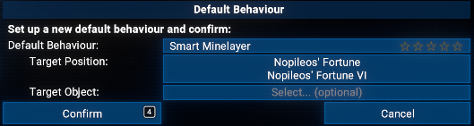

In the **Deployable** section pick the type, **Mines** or **Laser Towers**, and the item.

In **Shape**, **Concentric Shapes**, **Parallel Layers** and **Offset** design the field. The window shows how many items the slot needs.

In **Maintenance** set the **Replacement Threshold**: the share of a slot's items that must be lost before the ship refills it, 0 for at once. **Restock at Other Factions' Stations** lets the ship buy at stations that are not yours; a new order starts with your last choice.

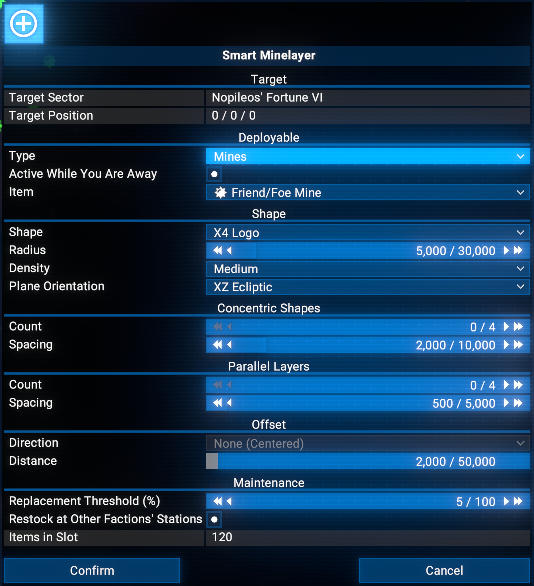

Confirm, and the ship flies to the field and lays it.

To change or delete a ship's slots, right-click it with no other object selected and choose **Configure Smart Minelayer** under **Orders**.

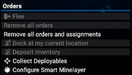

The window has one tab per slot, and the tab you are on can be changed. **Confirm** saves that slot, **Reset** brings back its saved values, **Close** leaves all slots as they are. While a tab has changes, the other tabs stay inactive until you confirm or reset.

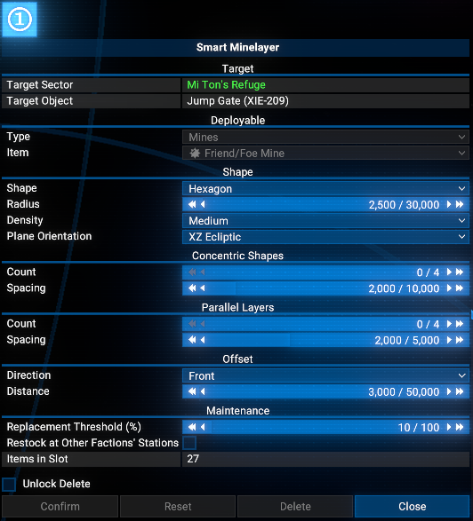

For another field, select the ship, right-click a spot in space, a station or a gate and choose **Add Minelayer Position**. It is offered while the ship has at least one confirmed slot and fewer than nine; the first slot always comes from the **Behaviour** panel.

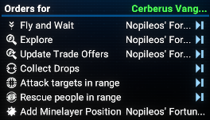

The window opens with a new tab beside the saved ones, and the map marks the new field; up to nine slots, one tab each. The saved tabs are read-only here: **Configure Smart Minelayer** changes or deletes them. A target that already has a slot gets one more. **Cancel**, Escape or closing the map drops the new slot again. A new target in its **Behaviour** adds no slot.

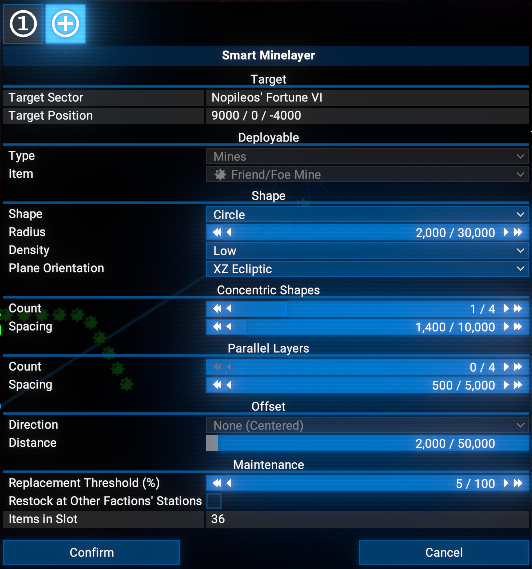

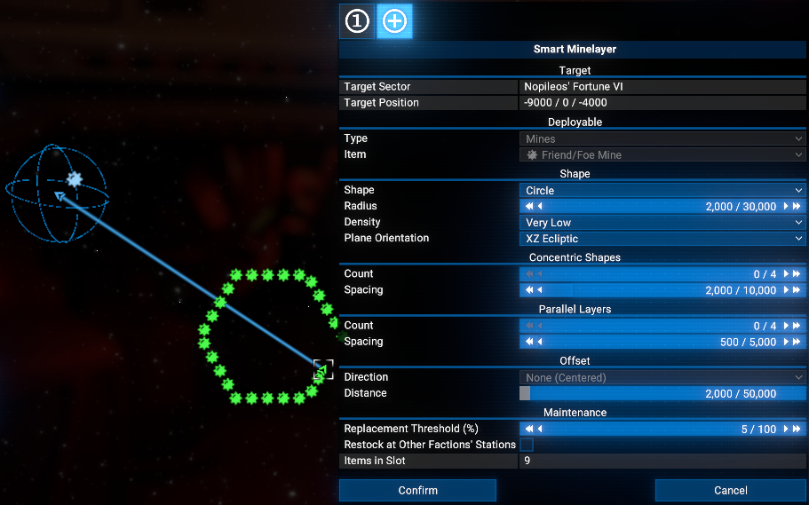

After **Confirm**, **Configure Smart Minelayer** shows both slots, one tab each.

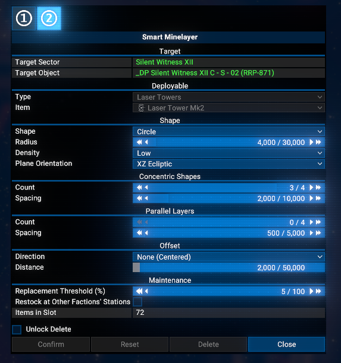

**Delete** removes the slot of the tab you are on: tick **Unlock Delete** above the buttons first. Then **Collect Items** appears beside it: ticked, the ship and its wingmen collect the slot's items, and those they do not lay again go back to a station as after a pattern change; the window no longer shows the slot, but it stays with the ship until its last item is collected. Left unticked, the items stay in space and are no longer replaced.

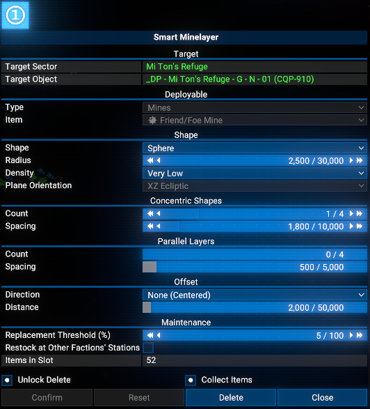

Deleting the last slot clears the order's target too: the ship and its wingmen collect the items if asked, then the ship stands by. **Configure Smart Minelayer** stays inactive; while items are still being collected its tooltip says so. Set a **Target Position** or **Target Object** in its **Behaviour** and confirm, and the window of the first slot opens again.

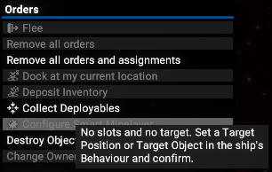

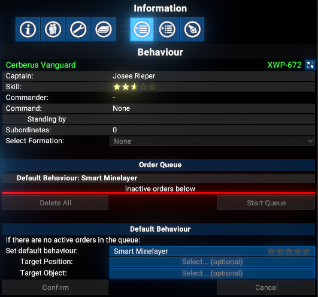

Cancelling the window of the first slot, with **Cancel**, Escape or by closing the map, leaves the ship the same way: no slot, no target, standing by.

Two fields on the map, each beside its slot:

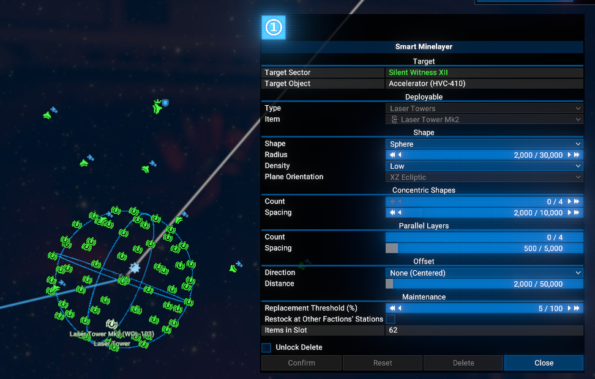

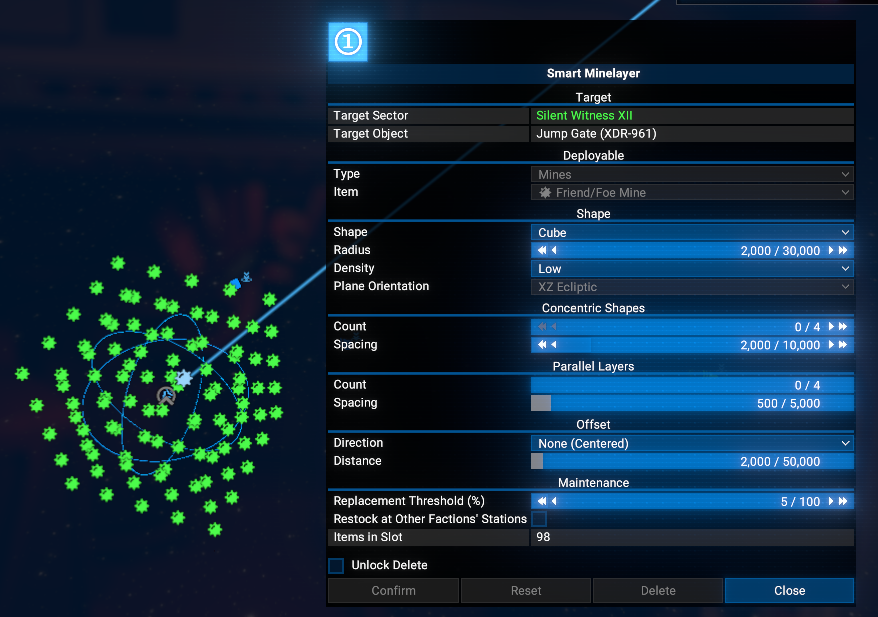

One minelayer with two slots in the same sector, one tab each:

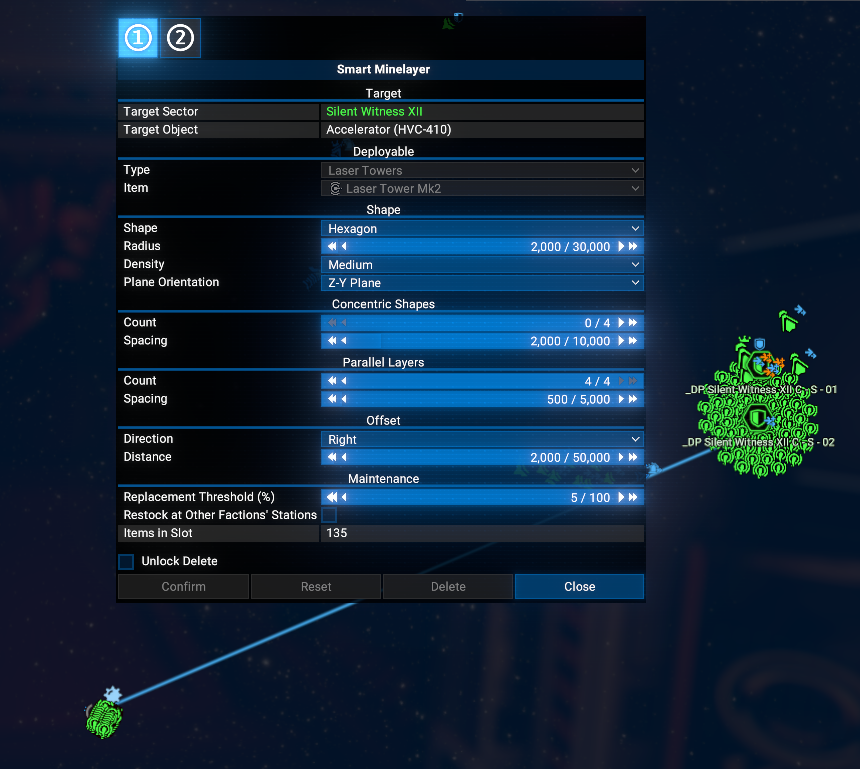

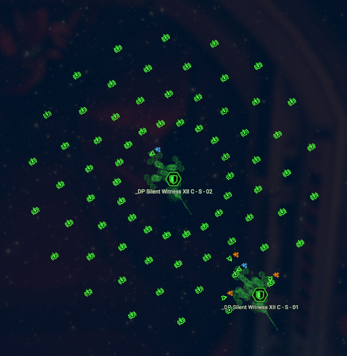

Parallel layers stack copies of a flat shape:

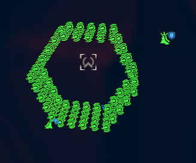

## Options

An options page is available via the `Extension Options` menu. **Keep Slots of a Destroyed Minelayer** shows how many game hours (1 by default) the slots of a minelayer destroyed without wingmen are kept before they are dropped; its friend/foe mines keep working either way. The slider is inactive in this version. **Debug Level** sets the detail of the extension's log.

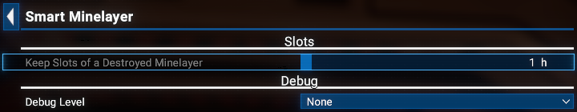

## Credits

- Author: Chem O`Dun, on [Nexus Mods](https://next.nexusmods.com/profile/ChemODun/mods?gameId=2659) and [Steam Workshop](https://steamcommunity.com/id/chemodun/myworkshopfiles/?appid=392160)
- *"X4: Foundations"* is a trademark of [Egosoft](https://www.egosoft.com).

## Acknowledgements

- [EGOSOFT](https://www.egosoft.com) - for the X series.
- [SirNukes](https://next.nexusmods.com/profile/sirnukes?gameId=2659) - for the Mod Support APIs that power the UI hooks.

## Changelog

### [1.00] - 2026-11-22

- **Added**
  - Initial public version
